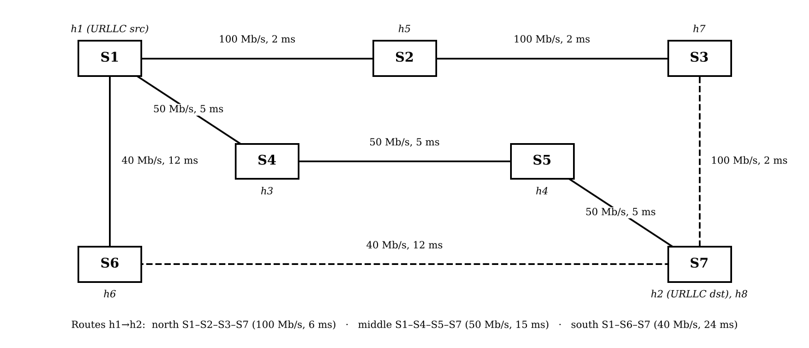
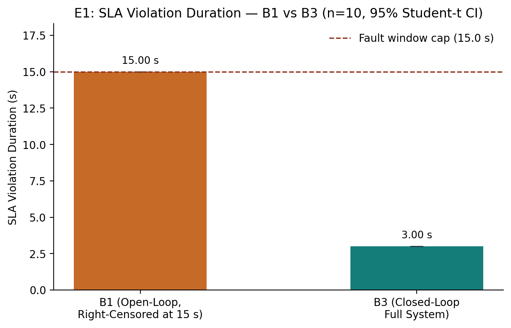
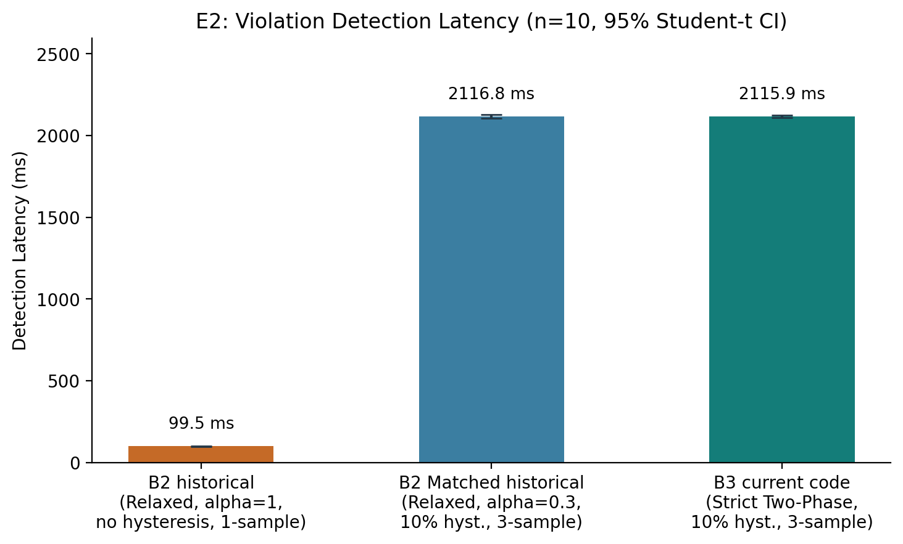
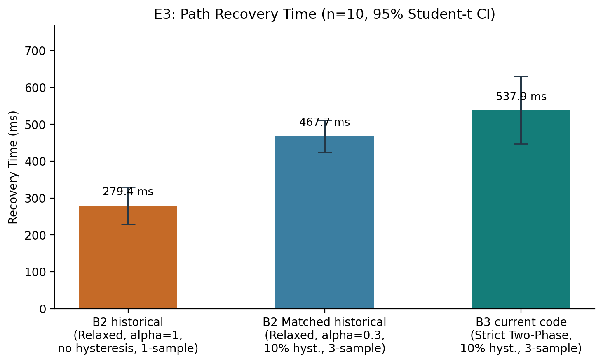
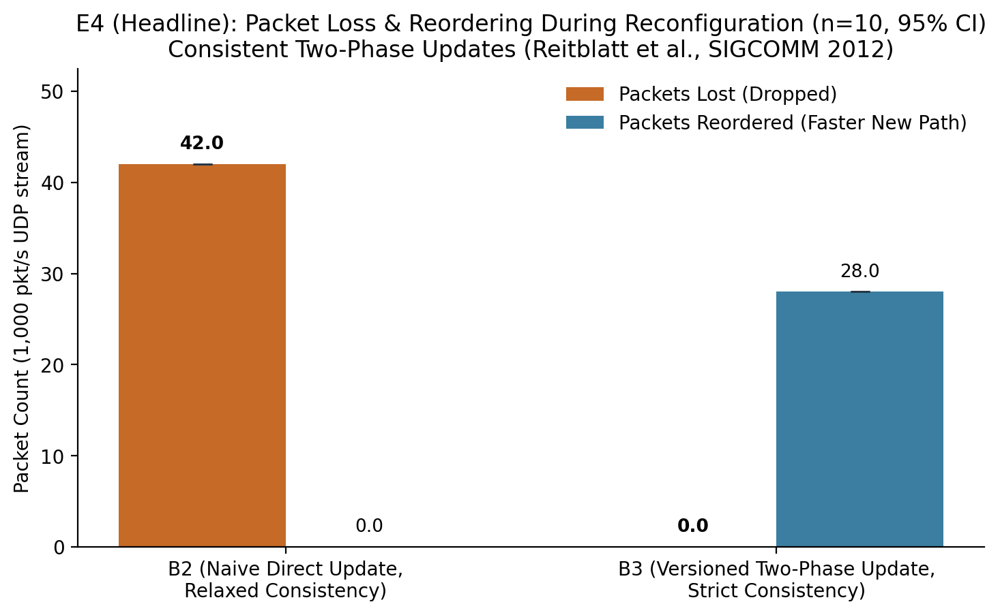
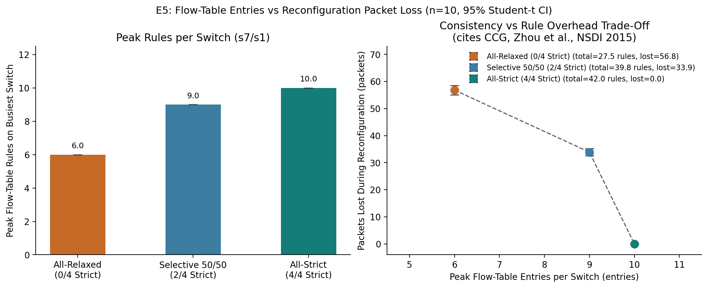
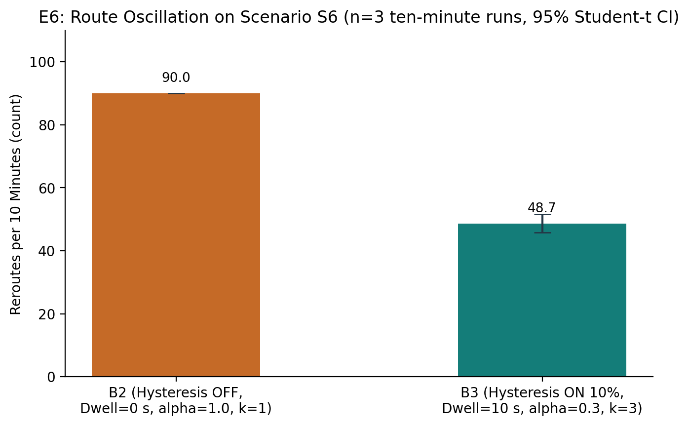
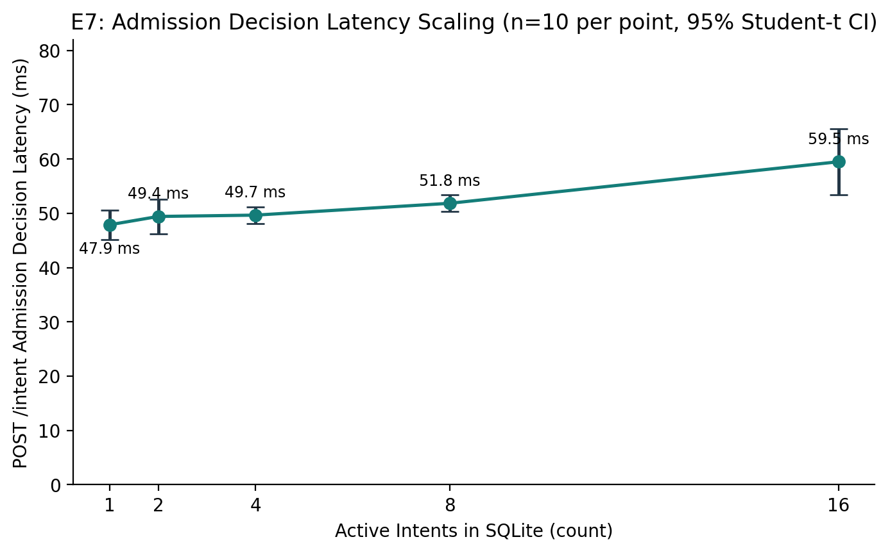
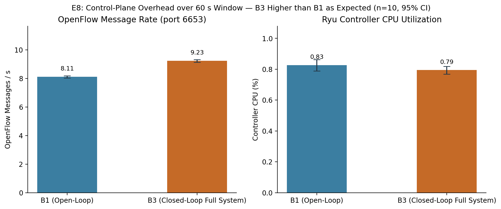
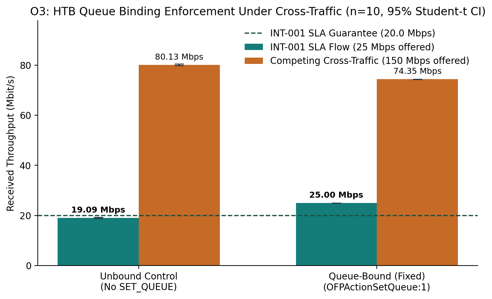

# Intent Based SDN for 5G SLA Enforcement

## Abstract

We implement and evaluate a transport-network service-assurance prototype. An operator submits a structured intent, the system validates it and checks residual resources, computes a feasible route, programs software switches, measures the service, and responds to confirmed violations. Strict intents use versioned consistent updates; relaxed intents use direct replacement. The results show the benefit of preserving packets during tested route transitions and suppressing oscillation, together with costs in reaction time, rule space, reordering, and control-stack CPU. The artifact integrates established methods and makes no algorithmic novelty claim. Demonstrations run on a live Mininet/Open vSwitch datapath inside Docker; illustrative dashboard samples are explicitly labelled and excluded from evaluation.

## 1 Introduction and objectives

Manual switch configuration requires an operator to map a service request onto routes, matches, ports, queues, and subsequent repairs. A service promise also needs ongoing measurement: installing a rule does not prove the requested service is delivered. This project makes that lifecycle explicit and reproducible on one machine.

Our objectives are to validate structured requests with explainable refusals; account for existing reservations; choose constraint-satisfying routes; enforce matches and bandwidth queues; detect sustained service violations; replan through a durable event boundary; and expose an understandable audit trail. Evaluation measures both benefits and costs of consistency and damping. The scope is a transport-network reference implementation motivated by 5G-style services, rather than a deployed radio or mobile-core system.

## 2 Literature review

Leivadeas and Falkner [1] survey the intent lifecycle, including expression, translation, resolution, activation, and assurance. Their discussion motivates a feedback loop that measures service behavior after activation. We instantiate those stages using a frozen structured grammar and path-level remediation. Natural-language interpretation and machine-learning assurance are outside the implementation.

Martini, Gharbaoui, and Castoldi [2] describe intent-based vertical-service slicing with feasibility checks, translation, deployment, and assurance over cloud and NFV infrastructure. Their recovery redeploys a slice. Our corrective action changes a transport path, so the workloads and timing scopes differ; we do not claim a direct speedup over their system.

Park and colleagues [3] review SDN and assurance across network-slicing domains. Their hybrid monitoring discussion motivates active observations together with passive counters. Our planner uses bottleneck bandwidth and summed link delays inside one transport domain. The implementation does not include RAN scheduling, a mobile core, FlexE, or segment routing.

Foerster, Schmid, and Vissicchio [4] survey consistent network updates and the tradeoffs among correctness properties, update rounds, and extra rules. This provides the design space for our strict and relaxed modes. A software-switch rule-capacity pilot cannot substitute for hardware TCAM evaluation.

Reitblatt and colleagues [5] establish consistent-update abstractions and a versioned two-phase method. Our strict implementation stages tagged rules, synchronizes processing, flips ingress classification, drains the old path, and removes the old version. The method is cited as prior work. The emulated drain interval is a deployment assumption rather than a general proof about packet lifetime.

Zhou and colleagues' CCG [6] enforces customizable consistency properties with verification and update scheduling. Our per-intent strict/relaxed choice follows the principle that stronger consistency has a cost. We do not implement CCG's invariant verifier, uncertainty model, or automatic fallback. These distinctions prevent presenting an educational integration as a new consistency algorithm.

## 3 System design

The processing pipeline is YAML or JSON intent -> M1 validation and persistence -> M2 admission -> M3 constrained path -> M4 rules and queues -> live software datapath -> M5 measurements and detector -> durable violation -> control-loop replanning. M6 reads the shared state and causal audit. SQLite provides the process boundary between telemetry and the Ryu controller. These are logical modules, not a requirement for a separate server per module. Compose provides the privileged SDN runtime, an API service, a read-only dashboard service, and a one-shot seed job. The Ryu controller and live collector run inside the SDN runtime during scenarios.

The topology is defined in topology/topology_spec.py and instantiated by topology/team16_topo.py. It contains seven switches, eight hosts, eight inter-switch links, and eight host-access links. A single Ryu controller programs the OVS switches. Three link-disjoint alternatives between the protected hosts have unequal budgets so the system has a meaningful selection problem. The s3-s7 and s6-s7 links are marked inferred and remain modelling assumptions. These counts describe configuration, rather than measured performance.

The frozen grammar contains traffic endpoints and protocol, optional destination port, priority, service guarantees, consistency, violation policy, and dwell. Supported guarantee types are minimum bandwidth, maximum latency, maximum loss, isolation from selected tenants, and avoided links. Actions are reroute, degrade, or alert_only. The schema and semantic validator define acceptance; no LLM interprets the request. Application names such as remote surgery label illustrative configurations and do not certify a clinical or standards-compliant service class.

## 4 Implementation

M1 parses the request, applies JSON Schema and semantic checks, stores an IntentRecord, and returns a decision with field-specific explanations. A schema rejection is distinct from a valid request rejected by admission.

M2 constructs a residual-capacity graph using persisted reservations and checks feasibility. Priority preemption is accompanied by durable state and removal of the victim's flow rules. M3 resolves endpoint addresses to access switches, enumerates bounded Yen candidate paths, prunes constraints, and selects deterministically. Modelled route bandwidth is the narrowest link and modelled delay is the sum of edge delays.

M4 generates bidirectional OpenFlow matches and actions with per-intent cookies. IPv4 protocol matches include the required Ethernet type. HTB queues use bits per second, derive egress ceilings from topology, and are selected by SET_QUEUE forwarding actions. Strict mode uses the established versioned update procedure; relaxed mode accepts a transient interruption during direct replacement.

M5 runs a separate live process with UDP echo observations and OVS flow-counter deltas. The live probe measures round trip, whereas planning uses configured one-way delays. The detector combines EWMA, a hysteresis band, consecutive confirmation, and a dwell timer. Confirmed events are persisted before Ryu dispatches them. ControlLoop computes an alternative excluding current route edges, installs it, persists the new path, and records a causal explanation.

M6 serves a read-only dashboard and JSON API. It displays intent state, computed or installed routes, recent measurements, and audit entries. The startup seed job provides application examples and labelled simulated samples when samples are absent. Subsequent live samples are displayed separately. Simulated samples never count as evaluation observations. CODE_WALKTHROUGH.md supplies file/function references and the full trace.

## 5 Evaluation methodology

The baseline contract comes from Section 11 of the supplied project plan. B0 uses static shortest-path forwarding without intents or monitoring. B1 installs intents open loop. B2 uses naive closed-loop recovery with relaxed updates and an immediate detector. B3 uses the full system. A matched-detector relaxed ablation helps distinguish detector cost from update cost. Historical and current-code run families remain separate in RESULT_PROVENANCE.md.

E1 measures violation duration; E2 measures detection latency; E3 measures event-to-install recovery; E4 counts packet loss and reordering around a route change; E5 measures peak rule populations; E6 counts reroutes over a fixed oscillation window; E7 times admission versus active-intent count; E8 measures control traffic and CPU. O3 separately checks data-plane queue binding under competing traffic. API response latency is not switch-install latency. E8's capture-based traffic field estimates control traffic using TCP PSH segments; it is not a parser that proves each segment contains exactly one OpenFlow message.

Each registered headline family uses independent repetitions, with its n shown in the generated tables. Intervals are two-sided Student-t intervals using sample standard deviation. Welch comparisons are used for nonzero variances; exact two-sided permutation comparisons are used when a group has zero sample variance. Deterministic repeated observations do not justify an infinite t statistic with a reported probability of zero. Open-loop violation duration is explicitly right-censored at the observation boundary.

Experiments run inside the Linux Docker image under WSL on the Windows host, using the project's pinned Python/Ryu stack and OVS software datapath. No claim is made about physical switching hardware. Raw CSV files are retained; changed-code runs and regression checks use distinct prefixes. An independent verifier checks registered summaries against raw values. The E6 event-accounting follow-up is documented with direct SQL counts and complete-sample checks; historical uncertain event counts are not treated as established causal evidence.

## 6 Results

The following tables are generated from registered summary files. They report measured means, sample deviations, and intervals rather than values transcribed into the builder. Historical baselines remain identified where current-code reruns are compared with them. The final E6 accounting rerun is added only after it completes and its durable event/path counts reconcile.

### B0 static forwarding baseline

Source: experiments/results/summary/b0_baseline_summary_20261025.csv

| Group | Metric | n | Mean | Sample SD | 95% t interval | Unit |
|---|---|---|---|---|---|---|
| B0 | loss | 10 | 0.000 | 0.000 | [0.000, 0.000] | % |
| B0 | rtt avg | 10 | 12.271 | 0.046 | [12.238, 12.304] | ms |
| B0 | throughput | 10 | 71.590 | 0.032 | [71.567, 71.613] | Mbits/s |

### B1 API response timing pilot

Source: experiments/results/summary/b1_open_loop_20261025.csv

| Group | Metric | n | Mean | Sample SD | 95% t interval | Unit |
|---|---|---|---|---|---|---|
| B1 | intent post response latency | 10 | 61.982 | 6.613 | [57.251, 66.712] | ms |

### E1 violation duration

Source: experiments/results/summary/e1_violation_duration_summary.csv

| Group | Metric | n | Mean | Sample SD | 95% t interval | Unit |
|---|---|---|---|---|---|---|
| B1 | sla violation duration s | 10 | 15.000 | 0.000 | [15.000, 15.000] | s |
| B3 | sla violation duration s | 10 | 3.003 | 0.000 | [3.003, 3.003] | s |

### Historical E2 and E3 baselines

Source: experiments/results/summary/b2_b3_closed_loop_20261025.csv

| Group | Metric | n | Mean | Sample SD | 95% t interval | Unit |
|---|---|---|---|---|---|---|
| B2 | detection latency | 10 | 99.467 | 4.498 | [96.249, 102.684] | ms |
| B2 | recovery latency | 10 | 279.355 | 70.552 | [228.889, 329.821] | ms |
| B2 matched detector | detection latency | 10 | 2116.845 | 13.402 | [2107.259, 2126.432] | ms |
| B2 matched detector | recovery latency | 10 | 467.711 | 59.878 | [424.880, 510.542] | ms |
| B3 | detection latency | 10 | 2104.262 | 3.994 | [2101.405, 2107.119] | ms |
| B3 | recovery latency | 10 | 618.535 | 82.519 | [559.508, 677.561] | ms |

### Current code B3 E2 and E3

Source: experiments/results/summary/b3_current_closed_loop_summary.csv

| Group | Metric | n | Mean | Sample SD | 95% t interval | Unit |
|---|---|---|---|---|---|---|
| B3-current | detection latency | 10 | 2115.940 | 10.073 | [2108.734, 2123.145] | ms |
| B3-current | recovery latency | 10 | 537.853 | 127.828 | [446.416, 629.289] | ms |

### Current code E4 transition behavior

Source: experiments/results/summary/e4_current_packet_loss_summary.csv

| Group | Metric | n | Mean | Sample SD | 95% t interval | Unit |
|---|---|---|---|---|---|---|
| B2 | packets lost | 10 | 41.000 | 2.160 | [39.455, 42.545] | packets |
| B2 | packets reordered | 10 | 0.000 | 0.000 | [0.000, 0.000] | packets |
| B3 | packets lost | 10 | 0.000 | 0.000 | [0.000, 0.000] | packets |
| B3 | packets reordered | 10 | 28.000 | 0.000 | [28.000, 28.000] | packets |

### E5 rule and loss tradeoff

Source: experiments/results/summary/e5_flow_table_summary.csv

| Group | Metric | n | Mean | Sample SD | 95% t interval | Unit |
|---|---|---|---|---|---|---|
| all relaxed | packets lost | 10 | 56.800 | 2.394 | [55.087, 58.513] | packets |
| all relaxed | peak rules max switch | 10 | 6.000 | 0.000 | [6.000, 6.000] | entries |
| all strict | packets lost | 10 | 0.000 | 0.000 | [0.000, 0.000] | packets |
| all strict | peak rules max switch | 10 | 10.000 | 0.000 | [10.000, 10.000] | entries |
| selective | packets lost | 10 | 33.900 | 1.792 | [32.618, 35.182] | packets |
| selective | peak rules max switch | 10 | 9.000 | 0.000 | [9.000, 9.000] | entries |

### E6 published oscillation series

Source: experiments/results/summary/e6_oscillation_summary.csv

| Group | Metric | n | Mean | Sample SD | 95% t interval | Unit |
|---|---|---|---|---|---|---|
| B2 | dwell suppressions | 10 | 0.000 | 0.000 | [0.000, 0.000] | count |
| B2 | reroute count 10min | 10 | 90.000 | 0.000 | [90.000, 90.000] | per 10 min |
| B3 | dwell suppressions | 10 | 28.700 | 2.111 | [27.190, 30.210] | count |
| B3 | reroute count 10min | 10 | 48.300 | 1.059 | [47.542, 49.058] | per 10 min |

### E7 admission scaling

Source: experiments/results/summary/e7_admission_scaling_summary.csv

| Group | Metric | n | Mean | Sample SD | 95% t interval | Unit |
|---|---|---|---|---|---|---|
| k=01 | admission decision latency ms | 10 | 47.889 | 3.789 | [45.179, 50.599] | ms |
| k=02 | admission decision latency ms | 10 | 49.420 | 4.427 | [46.253, 52.587] | ms |
| k=04 | admission decision latency ms | 10 | 49.665 | 2.123 | [48.146, 51.184] | ms |
| k=08 | admission decision latency ms | 10 | 51.845 | 2.109 | [50.336, 53.354] | ms |
| k=16 | admission decision latency ms | 10 | 59.496 | 8.463 | [53.442, 65.550] | ms |

### E8 corrected control stack overhead

Source: experiments/results/summary/e8v2_control_overhead_summary.csv

| Group | Metric | n | Mean | Sample SD | 95% t interval | Unit |
|---|---|---|---|---|---|---|
| B1 | control stack cpu pct | 10 | 0.939 | 0.045 | [0.907, 0.971] | % |
| B1 | openflow msgs per s | 10 | 8.194 | 0.073 | [8.142, 8.246] | msg/s |
| B3 | control stack cpu pct | 10 | 5.078 | 0.173 | [4.954, 5.201] | % |
| B3 | openflow msgs per s | 10 | 9.323 | 0.117 | [9.240, 9.407] | msg/s |

### Current code O3 bound queue

Source: experiments/results/summary/o3_current_queue_binding_summary.csv

| Group | Metric | n | Mean | Sample SD | 95% t interval | Unit |
|---|---|---|---|---|---|---|
| bound | intent loss pct | 10 | 0.000 | 0.000 | [0.000, 0.000] | % |
| bound | intent throughput mbps | 10 | 24.995 | 0.000 | [24.995, 24.996] | Mbps |

### Historical O3 bound and unbound comparison

Source: experiments/results/summary/o3_queue_binding_summary.csv

| Group | Metric | n | Mean | Sample SD | 95% t interval | Unit |
|---|---|---|---|---|---|---|
| bound | intent loss pct | 10 | 0.000 | 0.000 | [0.000, 0.000] | % |
| bound | intent throughput mbps | 10 | 24.995 | 0.000 | [24.995, 24.996] | Mbps |
| unbound | intent loss pct | 10 | 23.620 | 1.529 | [22.527, 24.714] | % |
| unbound | intent throughput mbps | 10 | 19.091 | 0.382 | [18.818, 19.365] | Mbps |

### E4 exact comparisons

packets lost: exact two-sided permutation; two-sided p = 1.0825088e-05. Source: e4_current_packet_loss_summary.json.

packets reordered: exact two-sided permutation; two-sided p = 1.0825088e-05. Source: e4_current_packet_loss_summary.json.

### Captured runtime environment

Python 3.9.25; Ryu 4.34; Mininet 2.3.1b4; ovs-vsctl (Open vSwitch) 2.17.12; kernel 6.18.33.1-microsoft-standard-WSL2. Captured by docs/capture_report_environment.py at 2026-11-02T19:46:12.859687+00:00.

### Evaluation figures

## 7 Discussion

Strict updates preserve packets in the tested transitions, while damping reduces route changes during alternating faults. Those benefits have measurable costs: confirmation delays detection, staging and draining delay installation, new packets can overtake old packets, and overlapping versions consume extra rules. The corrected mean B3-to-B1 control-stack CPU ratio is 5.408, calculated from E8v2's measured group means. It must not be interpreted as whole-machine CPU or extrapolated to a production deployment.

Low-rate probes establish reachability and detector behavior but do not load-test a bandwidth promise. O3 therefore offers sustained protected traffic with competing load and measures receiver throughput. The E4 interpretation is consistent with the configured path-delay difference and sequence rate; this is a timing explanation rather than a new theoretical guarantee. The historical E6 event-count shortfall is an accounting concern separate from the published path-revision metric and must remain disclosed until resolved by complete direct counts.

## 8 Limitations

The fixed topology and single-machine emulation limit generalization. Inferred links are design assumptions. Candidate search is bounded. Planning checks a one-way link-delay sum while live detection compares UDP round-trip delay with the same latency field; the implementation does not convert that budget between the two definitions. Its measurements therefore do not certify a common one-way latency SLA. A software-switch table pilot does not demonstrate hardware TCAM pressure. The drain interval is calibrated for the experiment, not a proven WAN lifetime bound. Forwarding selects a shared queue id on an egress port, so the single-protected-flow bandwidth experiment does not establish independent per-intent bandwidth isolation for concurrent services. Recovery computes an alternative directly on its topology graph without repeating M2 residual admission; contention-safe multi-intent recovery is not established. Queue reservations do not alone prove sustained delivered application throughput. Exact tests and confidence intervals describe these runs and do not remove workload, platform, or code-version confounders. Simulated dashboard data is for presentation only.

## 9 Conclusion and future work

The project implements a reproducible intent-to-enforcement and measurement loop with explainable admission, durable violation handling, and per-intent update consistency. Its evaluated strengths and costs are both visible in the generated results. The contribution is an integrated engineering artifact based on cited methods. Future work includes larger and changing topologies, controlled hardware experiments, stronger workload validation, durable provenance for each run, and validation of update-drain assumptions under wider delay distributions.

## References

[1] A. Leivadeas and M. Falkner. A Survey on Intent-Based Networking. IEEE Communications Surveys and Tutorials, 2023. DOI: 10.1109/COMST.2022.3215919.

[2] B. Martini, M. Gharbaoui, and P. Castoldi. Intent-based network slicing for SDN vertical services with assurance: Context, design and preliminary experiments. Future Generation Computer Systems, 2023. DOI: 10.1016/j.future.2022.12.033.

[3] K. Park, S. Sung, H. Kim, and J.-i. Jung. Technology trends and challenges in SDN and service assurance for end-to-end network slicing. Computer Networks, 2023. DOI: 10.1016/j.comnet.2023.109908.

[4] K.-T. Foerster, S. Schmid, and S. Vissicchio. Survey of Consistent Software-Defined Network Updates. IEEE Communications Surveys and Tutorials, 2019. DOI: 10.1109/COMST.2018.2876749.

[5] M. Reitblatt, N. Foster, J. Rexford, C. Schlesinger, and D. Walker. Abstractions for Network Update. ACM SIGCOMM, 2012. DOI: 10.1145/2342356.2342427.

[6] W. Zhou, D. Jin, J. Croft, M. Caesar, and P. B. Godfrey. Enforcing Customizable Consistency Properties in Software-Defined Networks. USENIX NSDI, 2015. https://www.usenix.org/conference/nsdi15/technical-sessions/presentation/zhou.
