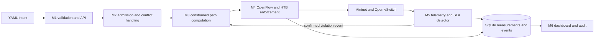

# Intent Based SDN for 5G SLA Enforcement

## BTech Project Progress and Implementation Report

**Student / Team:** [Name(s) and roll number(s)]  
**Institution:** [Institution and department]  
**Supervisor:** [Supervisor name]  
**Report type:** Project implementation and evaluation progress report  
**Date:** 26 October 2026

## Abstract

This report documents a compact intent-based software-defined networking prototype for enforcing transport-level service requirements associated with 5G-style services. A machine-readable YAML intent passes through schema validation, feasibility and admission checks, constrained path selection, OpenFlow and HTB enforcement, telemetry, violation detection, and controller re-planning. The design uses Ryu, Open vSwitch, Mininet, Python and a seven-switch emulated topology. The project checkpoint reports 261 passing and 11 skipped tests with clean Ruff in its Python 3.9 container; this Windows continuation independently ran four new focused tests and Ruff, but full-suite collection could not run under the available Python 3.12 because the pinned FastAPI/Pydantic versions fail during import. Docker is not installed on the continuation host, so no live experiment ran during this continuation.

The historical B2 closed-loop dataset contains ten runs. The reported detection persistence latency mean is 99.467 ms (sample SD 4.498 ms; two-sided 95% Student t interval 96.249–102.684 ms), and violation-to-path-install latency is 279.355 ms (SD 70.552 ms; interval 228.889–329.821 ms). Ten runs each recorded one successful reroute. The B3 dataset has one pilot only: 2,097.640 ms detection, 475.152 ms recovery and one reroute. That observation cannot support a B2/B3 significance test or a B3 confidence interval. A deterministic alternating trace added during this continuation exercised the real detector and dwell gate and recorded three confirmed violation events, four restorations, and two dwell suppressions; it did not invoke the live control loop or switch. The original E1–E8 definitions and ST-13/ST-14 briefs remain unavailable, and the protocol definitions used for these pilots remain proposals pending team confirmation.

## 1. Introduction

### 1.1 Background and problem

Software-defined networking separates a logically centralized control function from packet-forwarding devices, enabling software to compute routes and install forwarding rules. Intent-based networking raises the interface from low-level device configuration to a declarative statement of desired outcomes. For a 5G-style service, those outcomes may include bandwidth, latency, loss, isolation, or link avoidance. SLA enforcement requires a further loop: monitor the service, compare observations with guarantees, make a decision, apply a network change, and verify the result. These broad ideas are discussed in research on intent-driven slicing and network/service management [1,2].

The project addresses the engineering problem of making such a loop concrete and testable in a small software-defined transport network. A request must be validated, checked against path constraints and reserved capacity, translated into forwarding state, measured, and acted on when a persistent violation is observed. A testbed must also preserve evidence of what the controller decided and what route it installed.

### 1.2 Motivation and objectives

The objectives are to implement a bounded intent lifecycle; enforce resource and path constraints; monitor delay, jitter, loss, and throughput where instrumented; recover from confirmed SLA violations; make path updates observable and auditable; and evaluate behavior with reproducible scenarios and raw run data. The project also studies preemption, two-phase route updates, and detector damping within an emulated topology.

### 1.3 Scope, questions, and contributions

The implementation is a single-domain, transport-layer prototype using a fixed Mininet topology. It is not a 5G radio stack, commercial network slice manager, or production controller. It does not implement natural-language intent understanding, NFV MANO, distributed orchestration, or physical switch guarantees.

Research questions supported by the repository are: (1) can structured service requirements be translated into feasible routes and OpenFlow enforcement? (2) can telemetry-driven detection trigger a verified alternate route? (3) what response timings are observed in the supplied controlled fault experiments? (4) do strict updates and detector damping behave as expected in tests and a pilot? Current evidence answers the first two functionally and provides repeated B2 evidence for response times; B3 remains a single pilot.

Concrete contributions in this checkpoint are implementation artifacts: a frozen YAML grammar, feasibility and residual-capacity admission, path computation, OpenFlow enforcement, strict versioned updates, telemetry and detector transitions, audit/dashboard components, controlled B2/B3 scripts, and raw CSVs. They are not asserted as novel algorithms. The continuation adds a deterministic alternating detector/dwell replay, validation/aggregation code for existing B2/B3 files, focused tests, and documentation.

## 2. Literature Review

Three directly relevant studies were verified against publisher records. The full project-specific reviews, including methods, evidence, comparison, and limitations, appear in [docs/LITERATURE_REVIEW.md](LITERATURE_REVIEW.md).

#### 2.1 Martini et al. (2023): intent-based SDN network slicing

The research problem is how to translate vertical service requirements into deployable SDN connectivity while relieving the service owner from device-level configuration. The authors implement a NILE-based intent layer over an ETSI NFV MANO stack. It translates declarations into QoS-aware SDN-enabled network slices, supports service chaining, and checks slice behavior during the intent lifecycle. Their experiments cover two virtualized testbeds, with a metro scenario evaluated for slice instantiation, connectivity and throughput. The publisher describes feasibility and effectiveness testing; this report does not infer unsupported numeric values. The core insight is to bind declarative service promises to orchestration and continuous assurance. Our closest concrete modules are the YAML validator, admission/path modules, OpenFlow/HTB enforcement, and telemetry loop. We additionally implement local residual-capacity admission, preemption, two-phase updates and detector dwell in a fixed Mininet topology. We do not implement NILE, MANO, VNFs or service chaining. The existing B2 experiment has ten runs and B3 one pilot; neither tests the paper's testbeds or methods.

#### 2.2 Mehmood et al. (2023): structured review of intent-driven cellular management

This paper studies the broader design problem of intent processing and network/service management in future cellular systems. Its method is a structured review: the authors searched Scopus, IEEE Xplore, ACM Digital Library, ScienceDirect and WileyOnline, retrieved 5,484 records from 2015–2021, then screened to 60 unique studies. It synthesizes intent models, lifecycle, stakeholder roles, SDN/NFV integration, assurance and a converged architecture. It reports no single testbed or SLA measurements; its findings are that domain-agnostic intent representation, lifecycle translation, feasibility and feedback need further work, with learning also identified as a future function. For this repository, the review clarifies that a schema validator alone is not an IBN system: acceptance must lead to feasibility, enforcement and observed compliance. This project offers executable tests and a bounded network loop, unlike a literature synthesis, while lacking natural-language processing, learning, service-level orchestration and multi-domain operation. It addresses implementation integration, not the review's breadth.

#### 2.3 Hermosilla et al. (2025): multi-domain intent policy enforcement

The authors investigate policy correctness when intents span multiple administrative domains. They develop a model mapping system design descriptors to enforcement accuracy and build a proof-of-concept with intent resolution, policy generation, policy verification, multiple closed control loops, a multi-agent system, OpenStack, VPN interconnection, Docker, Python/Hy and SWI-Prolog. The experimental platform connected distant sites more than 10,000 km apart. The paper reports up to 99% overall policy accuracy, a 10% improvement, under 1.75 seconds to enforce its most complex intents, and model predictions up to 99% accurate. These findings are specific to its platform and definitions. The technical insight relevant here is to verify enforcement and use feedback loops at more than one level. Our repository verifies switch rules and route installation in scenario scripts and records causal events, but does not semantically verify arbitrary policy statements or federate domains. The added B2 raw data and B3 pilot measure a local emulated response; they do not replicate or outperform this study.

### Table A. Literature comparison

| Paper and year | Research objective and method | Environment and reported evidence | Relationship, difference, and project status |
|---|---|---|---|
| Martini et al. (2023) | Declare vertical-service needs as intents and deploy QoS-aware SDN slices via an NFV MANO intent layer | Two virtualized testbeds; metro scenario; instantiation, connectivity, throughput; feasibility/effectiveness assessed | Similar intent-to-enforcement/assurance lifecycle. This project has local Mininet/OVS admission, strict updates and detector; no MANO or slice chaining. B2 n=10; B3 n=1. |
| Mehmood et al. (2023) | Structured synthesis of IBN lifecycle and cellular network/service management | 5,484 initial records; 60 selected studies; no individual testbed experiment | Supplies design context, not a competing implementation. This project adds executable single-topology modules and tests; lacks the review's broad cellular and learning scope. |
| Hermosilla et al. (2025) | Model and improve correct enforcement of multi-domain intent policies | Multi-domain system across sites >10,000 km apart; authors report 99% accuracy and <1.75 s enforcement | Shares closed-loop policy execution. This project has controller-level route verification and local event evidence; lacks semantic verification, multi-agent resolution and OpenStack. |

The full citations, methods, detailed relationship, and limitations appear in [docs/LITERATURE_REVIEW.md](LITERATURE_REVIEW.md). Each cited study's findings belong to its authors and are kept separate from the measured status of this project.

Across the studies, the common chain is intent interpretation, resource/policy resolution, execution, and feedback. The SDN repository adapts that chain to a fixed YAML vocabulary and emulated network, with explicit feasibility, update consistency, detector state, and causal audit. It lacks the first paper's MANO and slicing service lifecycle, the second paper's broad cellular-management scope, and the third paper's distributed multi-domain semantic policy verification. The small topology and executable tests are the project's focus. The literature comparison is Table A in the literature review.

## 3. System Design and Architecture

### 3.1 Topology and components

`topology/topology_spec.py` is the topology source of truth: seven switches and eight hosts, with three link-disjoint routes between h1 and h2. The northern route has nominal 100 Mbps links and 6 ms one-way fabric delay; the middle route is 50 Mbps and 15 ms; the southern route is 40 Mbps and 24 ms. Two topology links are explicitly marked as inferred from the original ambiguous plan diagram. These are emulated budgets, not carrier guarantees [4].

The diagram describes repository modules rather than an external 5G architecture. M1 parses the fixed intent schema and exposes the REST interface. M2 checks path capacity and conflict/preemption policy. M3 computes and prunes candidate routes. M4 emits flow rules and queues; strict updates use versioned two-phase installation. M5 samples and evaluates telemetry using smoothing, consecutive confirmation, hysteresis, and dwell. M6 presents read-only operational state and causal audit. SQLite persists measurements, paths, and events.

### 3.2 Control and data flow

An intent defines a match, priority, one or more of five supported guarantee types, update consistency, and violation action. The admission and pathing modules determine whether a route fits bandwidth, latency, loss and explicit topology constraints; enforcement installs device state. Telemetry associates measurements with an intent and the detector emits state-transition events. The control loop consumes a valid violation event, excludes the current path, computes a feasible alternative, attempts installation, and persists the new path and audit outcome. The `src/telemetry/detector.py`, `src/telemetry/loop.py`, `src/common/models.py`, `src/common/db.py`, and `src/enforcement/` sources contain the relevant behavior.

### 3.3 Constraints

The intent grammar is intentionally frozen at five guarantee types and three violation actions. The topology is one emulated transport fabric; the Ryu 4.34 runtime is pinned to Python 3.9 inside Docker. Strict update staging temporarily requires versioned flow rules and a drain interval suited to this Mininet topology. It is not evidence of lossless production WAN reconfiguration.

## 4. Implementation

### 4.1 Technology stack

The source is Python. FastAPI exposes the API, JSON Schema validates intents, SQLite stores state, NetworkX supports graph/path calculations, Ryu handles OpenFlow 1.3, Open vSwitch forwards packets, and Mininet plus `tc`/HTB emulates topology budgets. The dashboard is read-only. The Docker image pins Ubuntu 22.04, Python 3.9.25, Mininet and Open vSwitch components as described in `Dockerfile` and `docker-compose.yml`.

### 4.2 Intent, admission, and path computation

`src/intent_manager/schema.json` defines the accepted document shape. `validator.py` rejects malformed or noncanonical fields. `src/admission/feasibility.py` evaluates candidate-path constraints, while `residual.py` accounts for admitted reservations. `src/pathing/yen_ksp.py`, `compute.py`, and `prune.py` form candidate routes and apply constraints. `src/enforcement/queues.py` and `flowmod.py` construct enforcement commands and rules. The project includes a preemption path for a higher-priority request when freeing one reservation makes an otherwise infeasible request feasible.

### 4.3 Monitoring, rerouting, and recovery

`src/telemetry/collector.py`, `probes.py`, `runtime.py`, and `detector.py` collect measurements and apply smoothing, consecutive sample confirmation, hysteresis and dwell. The control loop in `src/telemetry/loop.py` consumes confirmed events, avoids the failed current route, and reports install failures or successful path changes through audit events. `src/enforcement/two_phase.py` supports versioned strict updates; relaxed updates install directly. The dashboard and audit functionality are in `src/dashboard/` and `src/common/audit.py`.

### 4.4 Testing and errors

The existing tests exercise validation, admission, path selection, telemetry, detector transitions, enforcement and control-loop behavior. The continuation added tests for per-run CSV validation and aggregation, duplicate-record exclusion, malformed schemas, and deterministic alternating detector events. The supported container suite and lint baseline are reported by the checkpoint handoff; current-host checks are listed in Section 6.

## 5. Experimental Methodology

### 5.1 Environment and scenarios

The network experiments use the repository's privileged Docker service with Python 3.9, Mininet, OVS and Ryu. The Windows host used for this continuation has no Docker executable, so the live B3 repetitions and live alternating trace could not be run. The complete setup and Linux-backed commands are in [docs/REPRODUCIBILITY.md](REPRODUCIBILITY.md).

The handoff defines B0 as static forwarding, B1 as install-and-forget, B2 as relaxed closed-loop handling without hysteresis, and B3 as strict update with default damping. These are the local scenario profiles, not the missing authoritative project plan specification. The experiment proposal warns that its E1–E8 operational definitions require approval [5].

### 5.2 Measurements

The B2/B3 scenario files record detection persistence latency (first violating sample to event persistence log time), recovery latency (confirmed violation to causal path-installed event), and successful reroutes per run. These are operational definitions read from the runner; they are not asserted as official E1–E8. Throughput, loss and delay exist in other topology/scenario measurements, but their traffic windows are not interchangeable with event-response metrics.

Each run CSV is one independent observation for each metric. We calculate sample mean and sample standard deviation across run files. For n > 1, 95% intervals use the two-sided Student t critical value and standard error s/√n. A one-run sample does not produce a sample standard deviation or confidence interval. Malformed, duplicated, nonfinite, or wrong-unit values are reported as exclusions by the analysis script.

### 5.3 Alternating trace

The continuation's deterministic software replay alternates measured delay above and below the 20 ms threshold. It uses the production detector with alpha 1, 10% hysteresis, one-sample confirmation, and 10-second dwell. It calls the real detector but does not call the control loop or install a path. It measures detector event transitions and suppression timestamps, not live network reroutes.

## 6. Results and Analysis

### 6.1 Test and lint evidence

The supplied handoff reports 261 passed and 11 skipped tests under Python 3.9, with Ruff clean. On this continuation's Windows host, four newly added focused tests passed. Ruff was run on `src tests topology experiments` and passed after cleanup. The available bundled Python is 3.12.14; collection of the complete suite fails in the pinned FastAPI 0.95.2 / Pydantic 1.10.13 combination (`ForwardRef._evaluate()` missing `recursive_guard`) in dashboard/preemption test imports. The required pinned pandas 1.5.3 also failed to build under Python 3.12. Thus the historical full-suite count is independently unverified here and should not be presented as a new run.

### 6.2 B2/B3 findings

| Scenario / configuration | Valid runs | Metric and unit | Mean | Sample SD | 95% t interval | Interpretation |
|---|---:|---|---:|---:|---|---|
| B2 relaxed; alpha 1; hysteresis 0; one-sample confirmation | 10 | Detection persistence (ms) | 99.467 | 4.498 | 96.249–102.684 | Repeated response under the controlled primary-link delay |
| B2 same | 10 | Confirmed violation to path install (ms) | 279.355 | 70.552 | 228.889–329.821 | Large run-to-run spread; interval concerns this emulated protocol only |
| B2 same | 10 | Successful path changes (count/run) | 1.000 | 0.000 | 1.000–1.000 | One reroute recorded in each run |
| B3 strict; default detector | 1 | Detection persistence (ms) | 2,097.640 | — | Not estimable | Pilot only |
| B3 same | 1 | Confirmed violation to path install (ms) | 475.152 | — | Not estimable | Pilot only |
| B3 same | 1 | Successful path changes (count/run) | 1.000 | — | Not estimable | Pilot only |

The values and run-level inputs are traceable in `experiments/results/summary/b2_b3_comparison.json` and the referenced timestamped CSV files in `experiments/results/raw/`. The B2 series reproduces the handoff summary. B3's observed detection value is much longer than B2's, but one pilot and a different detector profile cannot establish typical performance or causation. No B2/B3 significance test or chart is warranted.

### 6.3 Alternating trace result

The replay CSV contains nine samples, five violation phases, and four recovery phases. It emits three confirmed violation events, four restored events, and two dwell-suppression events under the defined schedule. This validates expected detector event behavior in a deterministic replay. It does not establish packet-level SLA compliance or successful live reroute counts.

### 6.4 Literature comparison

The implementation has functional overlap with the intent-to-enforcement lifecycle in [1] and closed-loop policy enforcement in [3]. The observed response metrics cannot be compared with either paper's results because the systems, topologies, definitions, and experimental procedures differ. The work answers a smaller engineering question than the survey in [2]: whether the specific modules in this repository operate together under a controlled emulated fault.

## 7. Discussion

### 7.1 Demonstrated behavior

The checkpoint contains a complete source path for structured intent validation, admission, path computation, forwarding, telemetry, confirmed-event handling, rerouting, and audit. Its historical evidence includes integration scenarios and raw experiment data; its handoff claims the container's baseline tests and lint passed. The current continuation adds working data validation and aggregation, a deterministic detector/dwell trace, four passing focused tests, and updated technical documentation.

### 7.2 Threats to validity and limits

The emulated test topology is small, fixed, and uses software switching. The two inferred links are a documented resolution of ambiguity in the original diagram. Timing includes Python/controller, database, virtual-switch and emulation effects; it cannot be generalized to carrier networks. Only B2 has ten response-time repetitions; B3 has one. The B2/B3 profiles differ in detector and update behavior, and there are no hardware or radio-access experiments. The candidate evaluation contract is not approved. These factors constrain any causal or statistical claims.

### 7.3 Team decisions needed

The project team should provide the original E1–E8 metric contract, confirm B1–B3 scenario definitions, and supply the ST-13/ST-14 briefs. Once those are available, the experiment plan can align the runner, definitions and result reporting. The nine additional B3 runs and a live alternating fault/recovery experiment require a working Linux-backed Docker host.

## 8. Current Project Progress

### Table C. Milestone status

| Milestone | Status | Evidence | Incomplete work / dependency | Next action |
|---|---|---|---|---|
| Architecture and design | Completed for current checkpoint | `docs/architecture.md`, `docs/HANDOVER.md`, topology source and ADRs | Original topology drawing had ambiguous links; repository marks them inferred | Preserve documented topology decision |
| Existing implementation ST-1–ST-11 | Completed per checkpoint handoff | Source modules, integration scripts, tests; handoff details | Production-scale validation remains outside scope | Continue from frozen grammar |
| Test baseline | Partially verified in this environment | Checkpoint report says 261 passed / 11 skipped; 4 new focused tests pass | Full suite cannot collect under host Python 3.12; Docker unavailable | Rerun exact container command on Python 3.9 |
| B2 evaluation | Completed pilot series | 10 raw CSVs and machine-readable aggregation | Metrics remain proposal-level, not official E2/E3 | Team approves operational contract |
| Additional B3 evaluation | Blocked | One pilot raw CSV | 9 additional runs need Docker/Linux | Run `b3_closed_loop.sh --runs 9` in compatible container |
| Alternating violation/recovery | Partially completed | Deterministic detector replay CSV and 4 focused tests | No live ControlLoop, route install, or packet measurements | Run live trace on compatible Docker/Linux host |
| Statistical comparison | Partially completed | `experiments/analyze_closed_loop.py`; JSON with individual values and n-aware intervals | B3 n=1 prevents comparison inference; original metric contract absent | Add B3 observations and re-run analysis |
| Literature review | Completed for this report | `docs/LITERATURE_REVIEW.md`, verified publisher/DOI citations | Team may request alternative required papers | Review against course rubric |
| Documentation | Partially completed | Report, literature, experimental results, reproducibility Markdown | DOCX/PDF build and visual QA still required | Generate and inspect submission documents |
| ST-13/ST-14 | Pending | Brief absence recorded in handoff | Team specifications required | Obtain task briefs |

The handoff and Git history establish which code and raw data were already present at the `0249100` checkpoint. The alternating replay, analysis utility/tests and report documents were added during this continuation. No existing raw B0/B1/B2/B3 data were rewritten.

## 9. Conclusion and Future Work

This project demonstrates a bounded intent-to-enforcement and telemetry-driven recovery workflow in an SDN emulator. Ten historical B2 runs show repeatable response under their controlled scenario, while the single B3 pilot is only an observation. The deterministic alternating trace confirms detector and dwell transitions but is not a live network experiment. Four new tests and Ruff pass in the current host environment; full suite and live checks require the supported Python 3.9 Docker setup.

Next work is to rerun full tests and lint in the supported container, collect nine additional B3 runs, implement and execute the live alternating trace with route/event verification, confirm original metric and scenario definitions with the team, and complete ST-13/ST-14 after their briefs arrive. Future extensions may include multi-domain policy verification, hardware-aware flow-table evaluation, larger topologies, traffic-load sensitivity, and explicit end-to-end SLA compliance measurement.

## References

1. B. Martini, M. Gharbaoui, and P. Castoldi, “Intent-based network slicing for SDN vertical services with assurance: Context, design and preliminary experiments,” *Future Generation Computer Systems*, vol. 142, pp. 101–116, 2023. [DOI: 10.1016/j.future.2022.12.033](https://doi.org/10.1016/j.future.2022.12.033).
2. K. Mehmood, K. Kralevska, and D. Palma, “Intent-driven autonomous network and service management in future cellular networks: A structured literature review,” *Computer Networks*, vol. 220, article 109477, 2023. [DOI: 10.1016/j.comnet.2022.109477](https://doi.org/10.1016/j.comnet.2022.109477).
3. A. Hermosilla, P. Martinez-Julia, D. R. Lopez, and A. F. Skarmeta, “Multi-Domain Network Intent Policy Enforcement,” *Computer Modeling in Engineering & Sciences*, vol. 145, no. 3, pp. 4279–4316, 2025. [DOI: 10.32604/cmes.2025.072607](https://doi.org/10.32604/cmes.2025.072607).
4. Repository implementation evidence: `topology/topology_spec.py`, `docs/architecture.md`, `src/`, `tests/`, and `experiments/` (checkpoint commit `024910099e91bb8a3fbf1021249ce1eea0ea4dcf`).
5. Repository evaluation proposal: `docs/EVALUATION_PROTOCOL_PROPOSAL.md`, expressly marked as a proposal.

## Appendices

### Appendix A. Reproduction commands

See [docs/REPRODUCIBILITY.md](REPRODUCIBILITY.md) for setup, live experiment commands, and software-only trace reproduction.

### Appendix B. Result file map

- B2 raw per-run CSVs: `experiments/results/raw/b2_closed_loop_*.csv`
- B3 pilot: `experiments/results/raw/b3_closed_loop_20261025165852.csv`
- B2/B3 analysis: `experiments/results/summary/b2_b3_comparison.json`
- Alternating detector trace: `experiments/results/raw/alternating_trace.csv`
