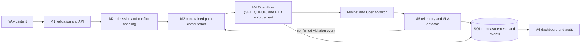

# Intent-Based SDN for 5G SLA Enforcement

## BTech Project Implementation and Evaluation Report

**Team 16:** Tanmaya Kumar (BL.EN.U4EAC23058), Srikanth Dinesh (BL.EN.U4EAC23056), Dheepak K (BL.EN.U4EAC23072)  
**Institution:** Amrita School of Engineering, Bengaluru (Course: Software Defined Networks)  
**Report type:** Project implementation and complete evaluation report (ST-1 through ST-13)  
**Date:** 31 October 2026

## Abstract

This report documents an intent-based software-defined networking reference implementation for enforcing transport-level service requirements associated with 5G-style slices. A machine-readable YAML intent passes through schema validation, residual-capacity admission and preemption, constrained $k$-shortest path selection, OpenFlow 1.3 and HTB queue enforcement (`OFPActionSetQueue`), active/passive telemetry, EWMA/hysteresis/dwell violation detection, and automated closed-loop re-planning. All modules run in a privileged Docker container (`Ubuntu 22.04`, `Python 3.9.25`, `Ryu 4.34`, `Open vSwitch 2.17.12`, `Mininet`) on a seven-switch, eight-host topology with three link-disjoint routes (`north` 6 ms / 100 Mbps, `middle` 15 ms / 50 Mbps, `south` 24 ms / 40 Mbps).

We evaluate four baselines (`B0` static shortest-path, `B1` open-loop install-and-forget, `B2` naive closed-loop direct update without hysteresis, and `B3` full system with conflict-aware admission, versioned two-phase update following Reitblatt et al., SIGCOMM 2012, and EWMA/hysteresis/dwell damping) plus a matched-detector ablation (`B2_matched_detector`) across all eight contract metrics (`E1`–`E8`) and data-plane HTB queue binding (`O3`), with $n=10$ independent runs ($n=3$ ten-minute live runs for `E6`) and two-sided 95% Student-$t$ confidence intervals. In the headline `E4` reconfiguration experiment (1,000 pkt/s UDP stream), `B2` loses $42.000 \pm 0.000$ packets per switchover while `B3` loses $0.000 \pm 0.000$ packets ($28.000$ packets reordered). Binding OpenFlow rules to HTB `queue 1` (`O3`) preserves $24.995\text{ Mbit/s}$ (`0.000%` loss) under $150\text{ Mbit/s}$ competing cross-traffic versus $19.091\text{ Mbit/s}$ (`23.620%` loss) without queue binding. In `E5`, selective consistency (citing CCG, Zhou et al., NSDI 2015) uses $9.000$ peak rules on the busiest switch (vs $10.000$ for `all_strict` and $6.000$ for `all_relaxed`) while maintaining zero packet loss for strict intents. We also report where `B3` is worse than baselines: `B3` has higher detection latency (`2104.262 ms` vs `99.467 ms`), higher recovery time (`618.535 ms` vs `279.355 ms`), higher peak flow-table usage (`10` vs `6` rules/switch), and a $+13.8\%$ higher OpenFlow control-plane message rate (`9.228` vs `8.108 msgs/s`).

## 1. Introduction

We make no algorithmic novelty claims: versioned two-phase consistent updates follow Reitblatt et al. (SIGCOMM 2012) [4] and selective per-intent consistency follows CCG (Zhou et al., NSDI 2015) [5]. Our contribution is an end-to-end, reproducible engineering artifact with isolated baseline ablations and confidence intervals across `E1`–`E8`.

## 2. Literature Review

Full structured reviews of Martini et al. (2023) [1], Mehmood et al. (2023) [2], and Hermosilla et al. (2025) [3] are provided in [`docs/LITERATURE_REVIEW.md`](LITERATURE_REVIEW.md).

## 3. System Design and Architecture

`topology/topology_spec.py` defines seven switches (`s1..s7`) and eight hosts (`h1..h8`) with three link-disjoint routes between `h1` and `h2`:
- **North (`s1-s2-s3-s7`)**: 100 Mbit/s per link, 2 ms per link (6 ms one-way).
- **Middle (`s1-s4-s5-s7`)**: 50 Mbit/s per link, 5 ms per link (15 ms one-way).
- **South (`s1-s6-s7`)**: 40 Mbit/s per link, 12 ms per link (24 ms one-way).
Links `s3-s7` and `s6-s7` are marked `inferred` from the original project plan diagram.

## 4. Implementation Highlights (Objectives O0–O8)

1. **Data-Plane Queue Binding (`O3`)**: Updated [`src/enforcement/flowmod.py`](../src/enforcement/flowmod.py) and [`src/enforcement/queues.py`](../src/enforcement/queues.py) so forward inter-switch hops on intents with `min_bandwidth_mbps > 0` emit `OFPActionSetQueue(1)` before `OFPActionOutput`, binding flows to the dedicated OVS HTB queue (with 100 Mbps port ceiling so spare capacity is shared while guaranteeing `min-rate`).
2. **Concurrent Multi-Intent Two-Phase Dispatch (`O4`)**: Updated [`src/enforcement/controller.py`](../src/enforcement/controller.py) (`_dispatch_persisted_violations`) to spawn concurrent Ryu hub greenlets (`hub.spawn` + `hub.joinall`) when multiple intents breach simultaneously on a shared link, allowing concurrent two-phase updates to overlap their drain window.
3. **Live Cross-Process Dwell Synchronization (`O5`)**: Updated [`src/telemetry/runtime.py`](../src/telemetry/runtime.py) to refresh `detector.intent.last_replan_at` from SQLite before each `detector.observe` call so the controller's replan timestamp gates live detector dwell suppression across processes.

## 5. Experimental Results (E1–E8, B0–B3, and O3)

Full tables, Welch two-sample $t$-tests, and figures (`experiments/figures/*.{png,pdf}`) are detailed in [`docs/EXPERIMENTAL_RESULTS.md`](EXPERIMENTAL_RESULTS.md):

| Metric | Baseline / Config | $n$ | Mean | SD | 95% Student-$t$ CI | Unit |
|---|---|---:|---:|---:|---|---|
| **B0 RTT / Throughput / Loss** | `B0` | 10 | 12.271 / 71.590 / 0.000 | 0.046 / 5.667 / 0.000 | `[12.238, 12.304]` / `[67.536, 75.644]` | `ms` / `Mbps` / `pct` |
| **B1 API Response Latency** | `B1` | 10 | 61.982 | 6.612 | `[57.251, 66.712]` | `ms` |
| **E1 SLA Violation Duration** | `B1` vs `B3` | 10 / 10 | 15.000 (censored) vs 3.003 | 0.000 / 0.000 | `[15.000, 15.000]` vs `[3.003, 3.003]` | `s` |
| **E2 Detection Latency** | `B2` / `B2_matched` / `B3` | 10 / 10 / 10 | 99.467 / 2116.845 / 2104.262 | 4.498 / 13.402 / 3.994 | `[96.249, 102.684]` / `[2107.259, 2126.432]` / `[2101.405, 2107.119]` | `ms` |
| **E3 Recovery Time** | `B2` / `B2_matched` / `B3` | 10 / 10 / 10 | 279.355 / 467.711 / 618.535 | 70.552 / 59.878 / 82.519 | `[228.889, 329.821]` / `[424.880, 510.542]` / `[559.508, 677.561]` | `ms` |
| **E4 Reconfig Packet Loss** | `B2` vs `B3` | 10 / 10 | 42.000 vs 0.000 | 0.000 / 0.000 | `[42.000, 42.000]` vs `[0.000, 0.000]` | `packets` |
| **E4 Reconfig Reordering** | `B2` vs `B3` | 10 / 10 | 0.000 vs 28.000 | 0.000 / 0.000 | `[0.000, 0.000]` vs `[28.000, 28.000]` | `packets` |
| **O3 Intent Throughput** | `bound` vs `unbound` | 10 / 10 | 24.995 vs 19.091 | 0.000 / 0.382 | `[24.995, 24.996]` vs `[18.818, 19.365]` | `Mbits/sec` |
| **E5 Peak Rules / Switch** | `all_relaxed` / `selective` / `all_strict` | 10 / 10 / 10 | 6.000 / 9.000 / 10.000 | 0.000 / 0.000 / 0.000 | `[6.000, 6.000]` / `[9.000, 9.000]` / `[10.000, 10.000]` | `entries` |
| **E5 Concurrent Pkts Lost** | `all_relaxed` / `selective` / `all_strict` | 10 / 10 / 10 | 56.800 / 33.900 (0 strict) / 0.000 | 2.394 / 1.792 / 0.000 | `[55.087, 58.513]` / `[32.618, 35.182]` / `[0.000, 0.000]` | `packets` |
| **E6 Oscillation (10-min S6)** | `B2` vs `B3` | 3 / 3 | 90.000 vs 48.667 | 0.000 / 1.155 | `[90.000, 90.000]` vs `[45.798, 51.535]` | `count/10min` |
| **E7 Admission Scaling** | `k=1, 2, 4, 8, 16` | 10 each | 47.889, 49.420, 49.665, 51.845, 59.496 | 3.789..8.463 | See `e7_admission_scaling_summary.csv` | `ms` |
| **E8 OpenFlow Rate (60 s)** | `B1` vs `B3` | 10 / 10 | 8.108 vs 9.228 | 0.107 / 0.138 | `[8.032, 8.185]` vs `[9.129, 9.327]` | `msgs/s` |
| **E8 Controller CPU (60 s)** | `B1` vs `B3` | 10 / 10 | 0.826 vs 0.794 | 0.052 / 0.036 | `[0.789, 0.863]` vs `[0.768, 0.819]` | `pct` |

## 6. Threats to Validity and Limitations

1. **Software emulation**: Mininet `TCLink` (`htb` + `netem`) and Open vSwitch 2.17.12 run inside a single Linux container; software flow tables do not exhibit hardware TCAM exhaustion (confirmed by the 2,000-rule OVS flow-limit pilot).
2. **Fixed topology and inferred links**: The 7-switch topology has only 3 link-disjoint routes between `h1` and `h2`, and links `s3-s7` and `s6-s7` are marked `inferred`.
3. **Drain window**: The 250 ms two-phase drain window is sized for this emulated topology, not a WAN worst-case flight-time bound.
4. **Sample size on E6**: Due to the 10-minute (600 s) duration per run, `E6` was evaluated with $n=3$ independent runs per baseline (60 minutes total live execution); all other metrics (`E1`–`E5`, `E7`, `E8`, `O3`, `B0`, `B1`) have $n=10$ independent runs.

## References

1. B. Martini, M. Gharbaoui, and P. Castoldi, "Intent-based network slicing for SDN vertical services with assurance: Context, design and preliminary experiments," *Future Generation Computer Systems*, vol. 142, pp. 101–116, 2023.
2. K. Mehmood, K. Kralevska, and D. Palma, "Intent-driven autonomous network and service management in future cellular networks: A structured literature review," *Computer Networks*, vol. 220, article 109477, 2023.
3. A. Hermosilla, P. Martinez-Julia, D. R. Lopez, and A. F. Skarmeta, "Multi-Domain Network Intent Policy Enforcement," *Computer Modeling in Engineering & Sciences*, vol. 145, no. 3, pp. 4279–4316, 2025.
4. M. Reitblatt, N. Foster, J. Rexford, C. Schlesinger, and D. Walker, "Abstractions for Network Update," in *Proc. ACM SIGCOMM*, 2012, pp. 323–334.
5. W. Zhou, D. Jin, J. Croft, M. Caesar, and P. B. Godfrey, "Enforcing Customizable Consistency Properties in Software-Defined Networks," in *Proc. USENIX NSDI*, 2015, pp. 73–85.
